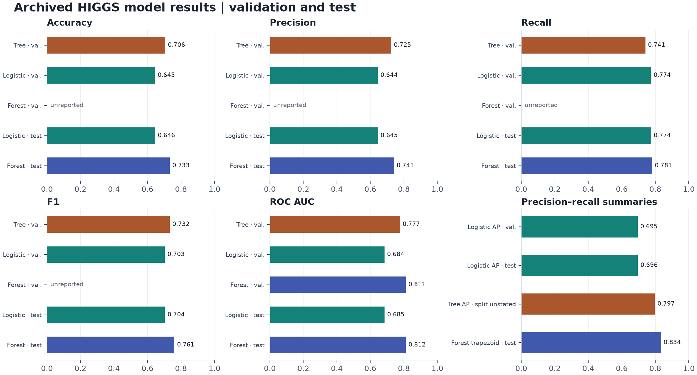
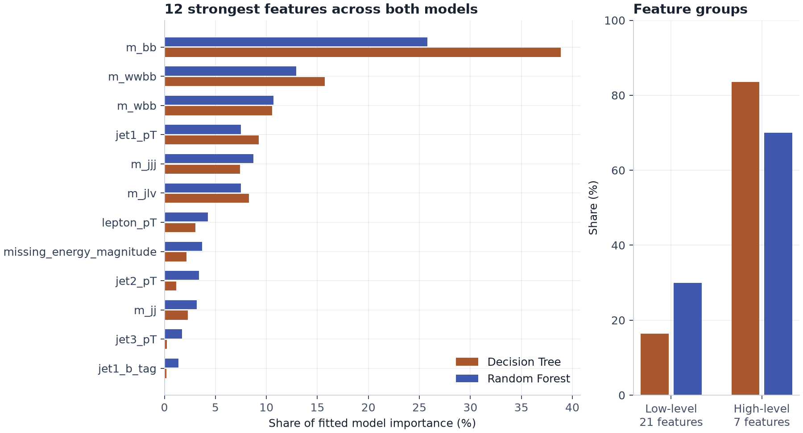
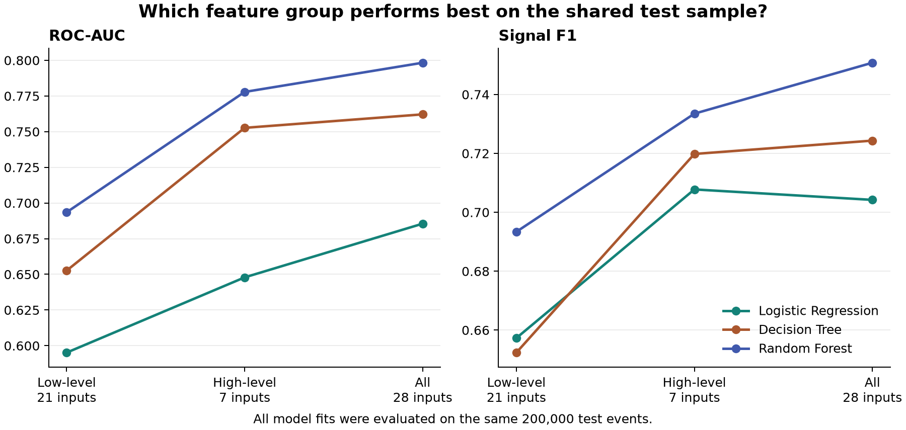
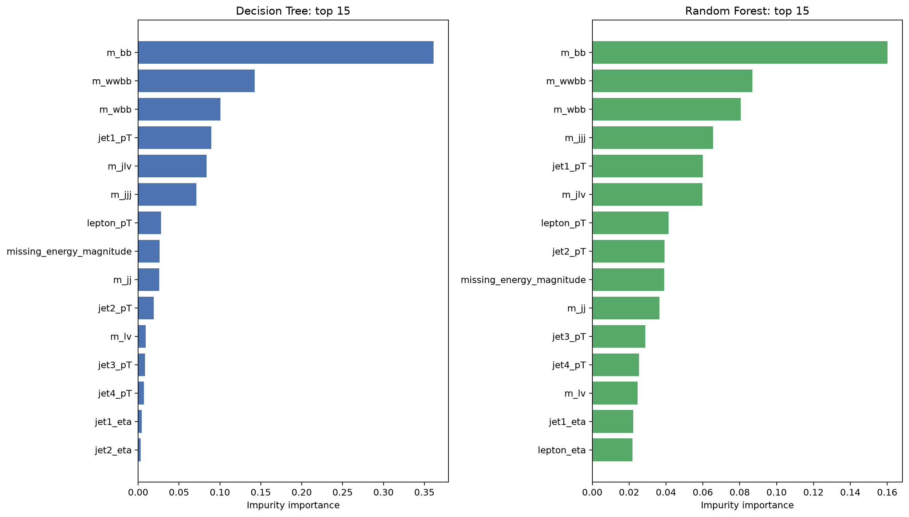

# Member 4 · Model comparison and feature analysis

ParticleX · HIGGS signal classification

## Archived model performance

| Model | Split | Accuracy | Signal precision | Signal recall | Signal F1 | ROC-AUC |
|---|---|---:|---:|---:|---:|---:|
| Decision Tree | Validation | 0.7059 | 0.7246 | 0.7405 | 0.7325 | 0.7767 |
| Logistic Regression | Validation | 0.6449 | 0.6444 | 0.7739 | 0.7033 | 0.6840 |
| Random Forest | Validation | — | — | — | — | 0.8114 |
| Logistic Regression | Test | 0.6456 | 0.6450 | 0.7742 | 0.7037 | 0.6848 |
| Random Forest | Test | 0.7327 | 0.7412 | 0.7810 | 0.7606 | 0.8116 |

On the team's archived test runs, Random Forest exceeded Logistic Regression on all five directly comparable metrics. Its test F1 was 5.68 percentage points higher, and its ROC-AUC was 0.1268 higher. It recovered 682,849 signal events, 5,879 more than Logistic Regression, and produced 134,194 fewer false alarms. The reports agree on the test size (1,608,196 events) and the class counts (874,369 signal and 733,827 background). Those counts agree with the project parquet. Matching counts do not establish that every archived prediction corresponds to the same event. The Decision Tree archive reports its metrics on validation, and the fresh test scores are reported below. On validation, the selected Random Forest candidate has the highest archived ROC-AUC, while Logistic Regression recalls more signal than the Decision Tree at their reported thresholds.

The original PR summaries use different definitions. Logistic Regression uses average precision (AP), **0.6947** on validation and **0.6957** on test. Random Forest uses trapezoidal PR-AUC, **0.8337** on test. The Decision Tree plot gives **AP = 0.7968** to four decimal places and does not label the split. The new notebook computes both summaries on the same predictions.

## Which inputs did the tree models rely on?

Both models rank the same three derived features first and in the same order. The six highest-ranked features are also the same in both models.

| Feature | Decision Tree share | Random Forest share |
|---|---:|---:|
| m_bb | 38.85% | 25.77% |
| m_wwbb | 15.73% | 12.92% |
| m_wbb | 10.55% | 10.69% |
| jet1_pT | 9.25% | 7.48% |

Together the seven high-level features account for **83.57%** of the Decision Tree's impurity importance and **70.02%** of the Random Forest's. The forest spreads more of its importance across other inputs. The full 28-feature rankings have a Spearman correlation of **0.888**. Impurity importance measures how the fitted model uses features to split events. Correlated observables can substitute for one another, and these importance shares alone do not measure the performance cost of removing a group.

## Feature group experiments on common splits

All nine fits used the same 200,000 training events, 200,000 validation events, and 200,000 held-out test events, sampled within the original partitions with stratification and seeds 42, 43, and 44. The test sample contained 108,739 signal events. The feature groups were 21 low-level lepton, jet and missing-energy observables, seven derived mass features, and all 28 inputs. Each model kept its settings across feature groups. Scaling for Logistic Regression was fitted on the training sample. Signal is class 1.

Random Forest with all features (28) had the highest ROC-AUC on validation (0.7992) and test (0.7983). Random Forest with all features produced 0.7508 F1 on test. Random Forest's ROC-AUC was 0.6935 with the 21 low-level features, 0.7778 with the seven high-level features, and 0.7983 with all 28.

All 28 inputs produced the highest test ROC-AUC for each model. Logistic Regression with seven derived features had the highest recall (0.8208), with precision of 0.6221. Its F1 was slightly higher with seven inputs (0.7078) than with 28 (0.7042), so the preferred group depends on whether the goal is ranking events or classifying them at the default threshold.

| Model | Feature group | Accuracy | Precision | Recall | F1 | ROC-AUC | AP | Trapezoidal PR-AUC |
|---|---|---:|---:|---:|---:|---:|---:|---:|
| Logistic Regression | Low-Level (21) | 0.5704 | 0.5804 | 0.7577 | 0.6573 | 0.5951 | 0.6359 | 0.6359 |
| Logistic Regression | High-Level (7) | 0.6315 | 0.6221 | 0.8208 | 0.7078 | 0.6479 | 0.6335 | 0.6335 |
| Logistic Regression | All Features (28) | 0.6470 | 0.6468 | 0.7728 | 0.7042 | 0.6855 | 0.6956 | 0.6956 |
| Decision Tree | Low-Level (21) | 0.6144 | 0.6398 | 0.6654 | 0.6524 | 0.6526 | 0.6776 | 0.6787 |
| Decision Tree | High-Level (7) | 0.6848 | 0.6966 | 0.7446 | 0.7198 | 0.7527 | 0.7739 | 0.7672 |
| Decision Tree | All Features (28) | 0.6956 | 0.7135 | 0.7355 | 0.7243 | 0.7621 | 0.7788 | 0.7742 |
| Random Forest | Low-Level (21) | 0.6400 | 0.6457 | 0.7487 | 0.6934 | 0.6935 | 0.7230 | 0.7230 |
| Random Forest | High-Level (7) | 0.7029 | 0.7158 | 0.7521 | 0.7335 | 0.7778 | 0.8053 | 0.8053 |
| Random Forest | All Features (28) | 0.7214 | 0.7309 | 0.7718 | 0.7508 | 0.7983 | 0.8224 | 0.8224 |

| Model | ROC-AUC change, high-level vs. low-level | ROC-AUC change, all vs. high-level | Highest test ROC-AUC group |
|---|---:|---:|---|
| Logistic Regression | +0.0527 | +0.0376 | All Features (28) |
| Decision Tree | +0.1001 | +0.0095 | All Features (28) |
| Random Forest | +0.0843 | +0.0205 | All Features (28) |

[Low-level metrics](results/metrics_low-level.png) · [High-level metrics](results/metrics_high-level.png) · [All-feature metrics](results/metrics_all.png) · [All validation and test scores](results/model_comparison_metrics.csv)

### Feature importance after refitting

In the new all-feature fits, the three highest-ranked features were `m_bb`, `m_wwbb`, `m_wbb` for the Decision Tree and `m_bb`, `m_wwbb`, `m_wbb` for the Random Forest. High-level features accounted for 79.44% and 51.40% of their respective impurity importance.

### Limitations and conclusion

The common split comparison supports the model and feature group findings for this stratified sample. The archive used full partitions under the team's original configurations, while the new runs used fixed settings and a single sample per split. The differences across these two runs reflect changes in sample size and potentially model settings. No uncertainty intervals or repeated-sample estimates were computed. The changes in ROC-AUC from refitting quantify feature group performance under this protocol, while the importance charts describe how the trained trees used their inputs.

The executed notebook and full-precision CSV record all 18 validation and test evaluations. Verification checked the split sizes, all nine fit configurations, four threshold-based metrics for consistency with integer class counts, and agreement of both 28-feature importance tables with the expected feature set and unit totals. Both precision–recall measures and ROC-AUC were computed from the model probabilities. The run used Python 3.14.7 and scikit-learn 1.9.1.

## Source folders and checks

- Decision Tree validation scores and row counts come from the performance and configuration tables. The full importance table comes from results, and the AP comes from the plot in graphs. [Decision Tree Drive folder](https://drive.google.com/drive/folders/1vUwyK6cTzQDtb8CWLexzrzvVWq6ZGMDj)
- Random Forest test scores, tuning ROC-AUC, importances and PR-AUC convention come from its CSV and JSON exports. [Random Forest Drive folder](https://drive.google.com/drive/folders/1ycBo8plJWi1q3ZroKQM7vofen2r76L0H)
- Logistic Regression scores come from the baseline validation comparison and test CSV. Its local team notebook supplies the AP calculation and the test confusion counts. [Logistic Regression Drive folder](https://drive.google.com/drive/folders/10tybPYNF4uBB9IpII3xHC2aWSFqZ_C_r)
- Accuracy, precision, recall and F1 were recalculated from the available confusion matrices. Both importance tables include all 28 features and sum to one. ROC-AUC and PR summaries were transcribed from the team's saved outputs.
